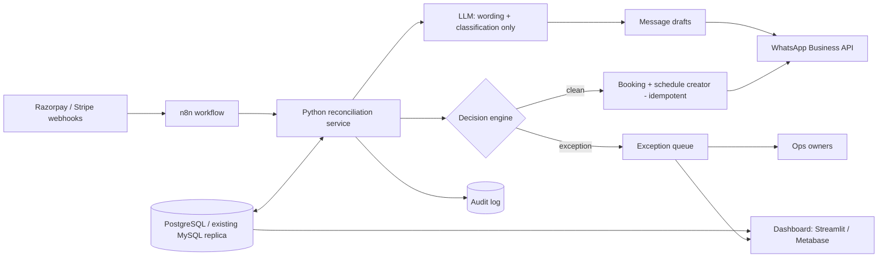

# System architecture

| Layer | Choice | Status |
|---|---|---|
| Rules engine | Python + pandas (`src/`) | **Built and tested** |
| State / idempotency | JSON ledger (prototype) -> unique key column in PostgreSQL | Prototype only |
| Orchestration | n8n: webhook -> HTTP call to engine -> branch | Design only |
| Payments | Gateway webhooks (signature-verified) | Design only |
| Messaging | WhatsApp Business API templates, human-approved at first | Design only (drafts generated) |
| Visibility | Streamlit dashboard (built); Metabase for production | Dashboard built |
| AI | LLM for classifying teacher remarks and polishing drafts, behind env key | Code path present, **not tested live** |

## Reliability patterns
Retry with exponential backoff on webhooks; dead-letter queue for failed runs; reconciliation job every 5 minutes re-evaluating open exceptions; feature flag per teacher cohort for shadow -> live; rollback = disable auto-approve flag and fall back to the manual queue (existing process continues unchanged).

## Security
No credentials in repo (`.env.example` only). PII masked in data; drafts avoid amounts, gateway ids and child names. Role-based access: Finance sees payments, teachers see only own students. Audit log immutable (append-only table).
